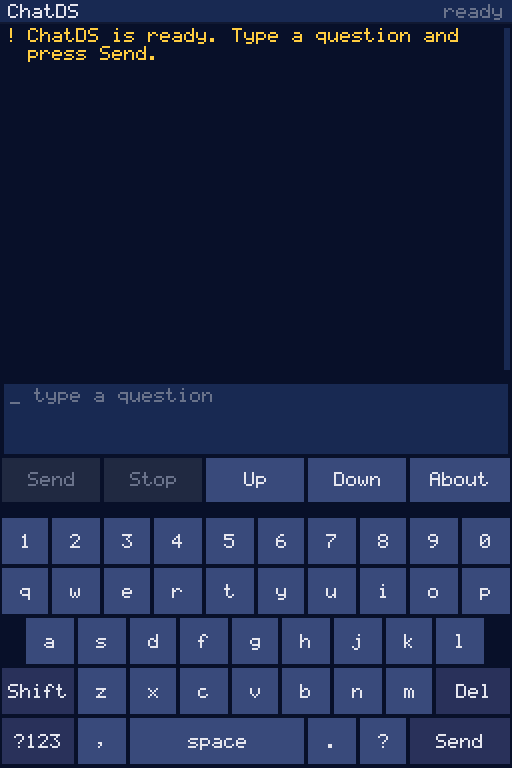

# chatds

chatds runs a tiny chat model on a nintendo ds lite. no network, phone or pc.
type on the touchscreen; the 67 MHz ARM9 looks up facts on the SD card,
evaluates `calc(...)` calls, draws small math plots and writes short python or
shell snippets.
the current model has 2.75 million parameters. it gets things wrong a lot.

the current release is **v0.2.0**: c24's rules, calculator parser, pocket math
notebook, text operations and ranked KB4 fact lookup answer first, two small
learned fallbacks catch conversation and text requests the rules miss, and the
model only fills the gaps. v0.2.0 adds owner-style rule fixes, casual math in
prose, an ARM assembly matvec kernel, a RAM reclaim, a provenance-clean model and
tokenizer, and an empty editor at startup.
**hardware-tested: owner ran this exact ROM (sha256 `b2e7a47b…100a`) on a real
DS via DSpico, 2026-10-21 (qualitative).**
[v0.2.0 notes](docs/RELEASE-v0.2.0.md), [c24 details, scores and gates](docs/PRODUCT-C24.md),
[c14](docs/PRODUCT-C14.md).



the gif uses the independent engine in headless melonDS with scripted touch
input. playback is accelerated, not a speed measurement.
[capture provenance](docs/demo.json).

## measured speed

**emulated DS timer measurements**, not host wall time or physical DS timings.
resident DSQ8 weights, int16 Q8.8 KV, context 256, frozen KB2 assets. the full
product ROM includes the tokenizer, retrieval, calculator and touch UI.

| question | first token | decode steps/s | total |
|---|---:|---:|---:|
| who was george washington | 12.314 s | 3.405 | 17.599 s |
| whats 38 times 47 | 3.522 s | 3.631 | 6.551 s |
| sort scores biggest first | 3.522 s | 3.613 | 8.227 s |

these numbers predate c14, which now answers calculator questions without the
model. these complete runs were **2.68–2.74× faster** than the historical black-box
baseline. first token includes retrieval, tokenization and prefill; excludes
model loading and screen refresh. decode throughput includes the EOS prediction,
not generated tokens divided by the whole run. largest main-RAM heap-break
proxy: **3,653,632 bytes**. this is not a stack or live-allocation peak.
[method, binary hashes and raw results](docs/ENGINE-BENCHMARK.md).

## get the kit

download `chatds-v0.2.0-sdcard.zip` from the
[v0.2.0 release](https://github.com/papayuh/chatds/releases/tag/v0.2.0), extract
it on a PC and copy `chatds.nds` plus `chatds/` to the card root (see [run](#run)).
don't copy the ZIP itself to the card. the kit has the ROM (sha256
`b2e7a47ba0c4509fdbefa6401261f6717810ec6bfad8f447ea2b92d88e1b100a`), the
2,986,240-byte DSQ8 model, its 2048-token tokenizer, the KB4 index, the three
learned heads, and license/attribution files.
hardware-tested: owner ran this exact ROM (sha above) on a real DS via DSpico,
2026-10-21 (qualitative). no timings were recorded.

the [v0.1.0 release](https://github.com/papayuh/chatds/releases/tag/v0.1.0) is
historical: older ROM, KB3 and the previous model/tokenizer pair. don't mix its
`tok.bin` with the v0.2.0 `model.bin`.

**training runs on a PC with PyTorch, usually a GPU—not on the DS.** the DS
only runs inference. training your own model is optional; see [train/](train/README.md).

code, pretrained model and runtime tokenizer: **MIT**. the Wikipedia-derived
index and retrieved text: **CC BY-SA 4.0**, not MIT. preserve the included
`chatds/kb-ATTRIBUTION.txt` and `licenses/CC-BY-SA-4.0.txt` when redistributing;
identify further changes and share adapted text under the same or a permitted
compatible license. the kit includes separate MIT model/tokenizer and linked
runtime notices. [weights release review](docs/WEIGHTS_RELEASE_REVIEW.md).

## build from source

linux, `make`, a C compiler, python 3 and
[BlocksDS](https://blocksds.github.io/docs/) are required.

```sh
bash tools/install-blocksds.sh  # installs into ~/opt/wonderful
source tools/env.sh
make                           # clean/product/build/chatds.nds
make host                      # clean/product/build/chatds-host
```

binaries and full datasets are not committed to the source tree. use the
v0.2.0 kit's `chatds/model.bin`, `chatds/tok.bin`, `chatds/kb4.bin` and
`chatds/kb-ATTRIBUTION.txt` in the packaging command below (or build a KB4 with
`corpus/kb/build_kb4.py`), or supply your own compatible licensed assets. this
tree includes unreleased storage changes; for a byte-identical v0.2.0 rebuild,
see the [release rebuild instructions](docs/RELEASE-v0.2.0.md#rebuild).
model shape is read from the file, not baked into the ROM. unsupported layouts,
mismatched vocabulary sizes and malformed files are refused.

```sh
bash ds/hwkit/make-kit.sh --mode assistant \
  --model path/to/model.bin --tokenizer path/to/tok.bin \
  --kb4 path/to/kb4.bin --kb-attribution path/to/ATTRIBUTION.txt \
  --prompt 'whats 38 times 47' --out build/chatds-kit
```

omit both KB options to run without fact retrieval; `--kb` stages a legacy KB3
index instead of `--kb4`. the notebook is in the ROM and needs no card files.
packaging stages files; it never writes a physical card.
`ds/hwkit/smoke-test.sh` expects transformer-only answers, so it is not a c14/c24
validator; see [kit testing](ds/hwkit/README.md#testing).
`--asset-dir DIR` takes `model.bin`, `tok.bin` and their `SHA256SUMS` together.

## tokenizer assets

the pretrained kit already includes the runtime tokenizer matching its weights;
do not replace it with a freshly trained tokenizer. original SentencePiece
`.model` files are not included. to train **your own** tokenizer/model, use
UTF-8 text you have rights to use:

```sh
python3 -m pip install sentencepiece
python3 tools/train_tokenizer.py --input path/to/your-text.txt \
  --prefix build/my-tokenizer --vocab-size 2048
python3 ds/tokenizer/tokbin.py build/my-tokenizer.model build/tok.bin
```

this trains a **new** tokenizer, not the tokenizer used by existing weights.
train your model with that exact `.model`, or obtain a matching licensed
tokenizer from your weight provider. matching vocabulary sizes alone is not
enough. [training instructions](train/README.md) describe checkpoint training and the
standalone clean-room DSQ8 exporter. host tests generate small synthetic
tokenizers locally and need no pretrained assets.

## train -> export -> host check -> melonDS

Train with the exact tokenizer used for your shards/checkpoint; see
[train/](train/README.md) for the optional trainer dependencies. Export trusted
float checkpoints on CPU, then smoke-test the clean host before emulation:

```sh
python3 train/train_instruct.py --data_dir=path/to/shards --out_dir=build/training \
  --device=cpu --compile=False
python3 train/export_dsq8.py --ckpt build/training/ckpt.pt \
  --tok build/tok.bin --tok-model build/tokenizer.model --out build/model.bin
make -j2 host
mkdir -p build/export-host
printf 'steps=8\nkbd=0\ninstruct=0\nprompt=Once upon a time\n' > build/export-run.txt
clean/product/build/chatds-host build/model.bin build/tok.bin - \
  build/export-run.txt build/export-host/
make -j2
QT_QPA_PLATFORM=offscreen python3 tools/engine_golden.py run \
  --rom clean/product/build/chatds.nds --model build/model.bin --tokenizer build/tok.bin \
  --question 'Once upon a time' --no-instruct --steps 8 \
  --work build/export-melon --timeout 120 --output build/export-melon/result.json
```

Use a fresh emulator work directory, verify no window/display connection, and
skip emulation if headless operation cannot be verified. These are transformer
smokes, not quality or c24 parity gates. The exporter needs only PyTorch/NumPy,
not upstream converter code; its hash sidecar pins the emitted model/tokenizer.
`python3 -m pytest -q train/test_export_dsq8.py` runs synthetic export/clean-engine
checks without checkpoints or large binaries in git. Package validated assets
with `ds/hwkit/make-kit.sh` for c24; see [kit testing](ds/hwkit/README.md#testing).

## run

use a DS lite with a DLDI flashcart; DSpico is the intended target. back up the
card, then copy `chatds.nds` and `chatds/` from the kit to its root. don't replace
the flashcart bootloader. eject cleanly and launch `chatds.nds`.

**source builds only:** this tree adds launch-selected storage for DSi internal
SD; the published v0.2.0 ROM does not contain this fix. real DSi/TWiLight support
remains unverified. internal SD needs a launcher mode with SD access (normally
DSi mode); a DS-mode launch cannot gain that access from this path fix.

at boot, the source-built ROM prints `storage: fat:/chatds/` for DLDI or
`storage: sd:/chatds/` for internal SD. keep `chatds/` at the selected card's
root even when the ROM is in a nested folder. all assets, results and logs stay
on that card; missing files or write errors never trigger fallback to another
card. the app does not create missing directories.
[storage design and hardware acceptance plan](docs/specs/dsi-sd-storage.md).

- touch **Send**, keyboard return or **START** to ask.
- **B** or **Stop** cancels between engine steps. **Up/Down** scrolls.
- **About** or **SELECT** opens credits. **Bksp** deletes a character.
- input is ASCII, at most 127 bytes. each model question starts with fresh KV; a
  small dialogue record carries follow-ups ([details](docs/PRODUCT-C14.md)).

results go to `chatds/out.txt`, `ids.txt`, `ctx.txt`, `calc.txt` and `heap.txt`.
`status=OK` means inference and file writes completed, not that the answer is
correct. in source builds, a failed `debug.log` write also makes publication
fail. `cannot read run.txt` reports the selected path and errno: check extraction,
card access and launch mode. `malformed run.txt` means the file was read but its
values are invalid (`steps` must be 1..256). a later `result publication failed`
message is a separate write error; check the earlier diagnostic first.
python and shell answers are text, never executed. see
[kit/emulator setup](ds/hwkit/README.md) for melonDS use.

## pocket math notebook

after the calculator declines, short plot, bar and table requests draw on the
top screen without the model: `graph sin x`, `plot x squared from -5 to 5`,
`show bars for 3, 8, 2, 6`, `table of 2^n for n 1 to 8`. plots default to
-5..5. it uses integer math (four decimal places, ±10000), ranges within ±100,
2..129 points, 1..16 bars or table rows and expressions of at most 32 nodes.
requests over those bounds get a polite refusal; prose such as
`plot 2001 a space odyssey` falls through to the normal pipeline.
[arithmetic contract](clean/ARITHMETIC.md#pocket-math-notebook-prototype).

## test and develop

```sh
python3 -m pip install pytest numpy sentencepiece
make test
make -C clean sanitize
make -B -C clean/ui SAN=1 test
python3 eval/score.py --selftest
python3 eval/score.py --negative-selftest
```

host tests use synthetic models and a small KB fixture. optional training tests
report missing MIT training dependencies rather than silently claiming coverage.
[training](train/README.md), [corpus tools](corpus/README.md),
[clean host evaluation](eval/README.md) and [device compatibility](docs/ENGINE-GOLDEN.md).

## limits and licenses

facts can retrieve the wrong article. names get garbled; answers can be invented.
the product retains 31/33 frozen compatibility behaviors, including five clean
oversized-input rejections. two numerical differences have exact pinned outputs;
[details](docs/ENGINE-SWAP-INVESTIGATION.md). c14, a c24 ROM and the v0.2.0 ROM
have run on a real DS, but no physical DS timing or stack-canary run has been recorded.

ChatDS code is MIT-licensed; see [LICENSE](LICENSE). the owner also releases the
kit's trained model and runtime tokenizer under MIT; see its
`licenses/MODEL-TOKENIZER-MIT.txt`. the code-only source
[release audit](docs/PUBLIC_RELEASE_AUDIT.md) is historical; the pretrained
release notes and included notices describe the separate binary/data release.

the v0.2.0 model and tokenizer were trained only on project generators,
Wikipedia-grounded answers and a small set of Claude- and GPT-written pairs; no
GLM- or DeepSeek-authored data. details in the
[weights release review](docs/WEIGHTS_RELEASE_REVIEW.md). no underlying training
corpus is included. answers remain AI-generated and can be wrong.

BlocksDS/libnds and its runtime retain their own licenses. Wikipedia-derived
index/context data is CC BY-SA 4.0. the v0.1.0 tokenizer's TinyStories
training data is CDLA-Sharing-1.0; v0.2.0's tokenizer does not use it. optional training uses the MIT llama2.c/ds-llm fork and nanoGPT
configurator. melonDS is GPLv3 and is a test tool, not shipped in the kit.
DSpico firmware/DLDI is by the LNH team.
[third-party notices](THIRD_PARTY_NOTICES.md).
